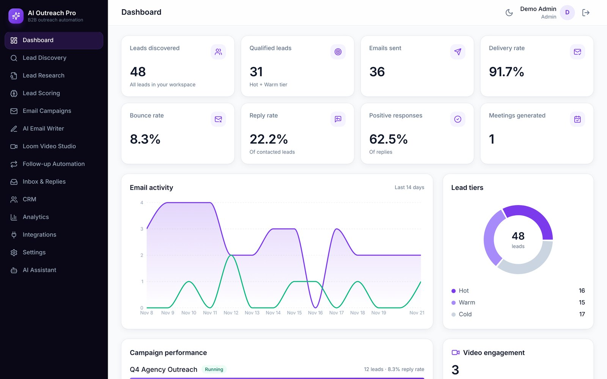
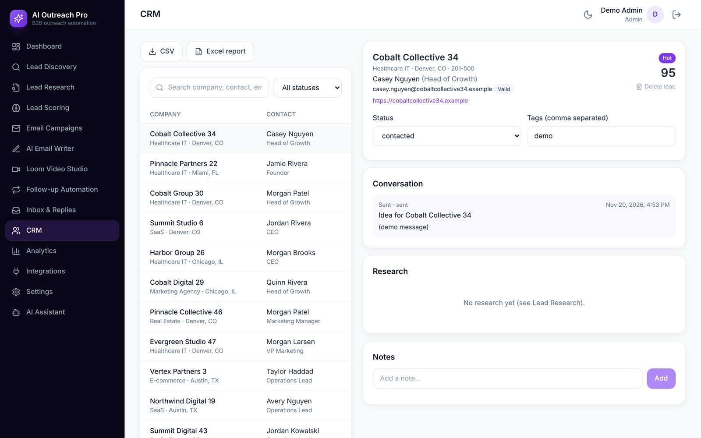
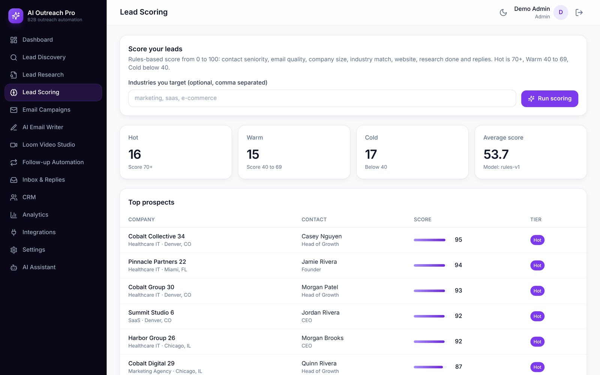
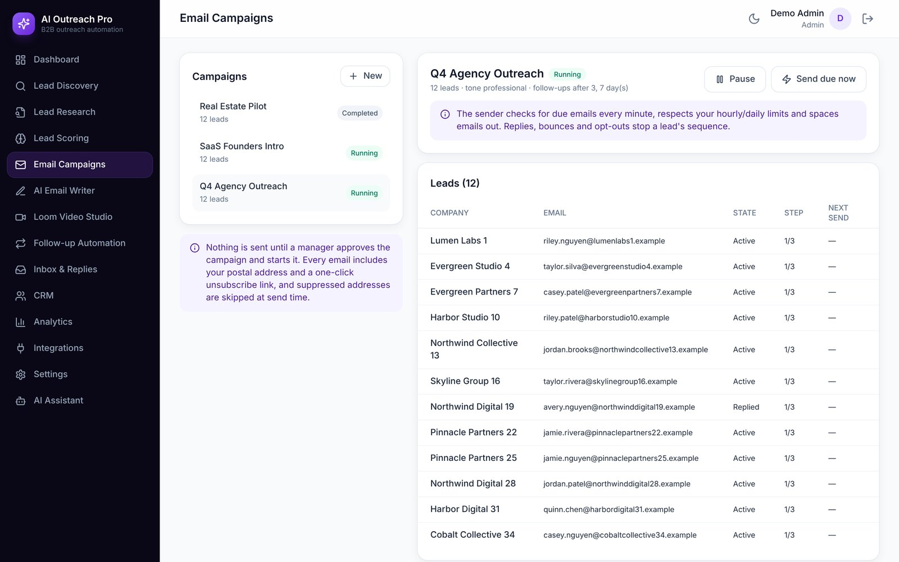
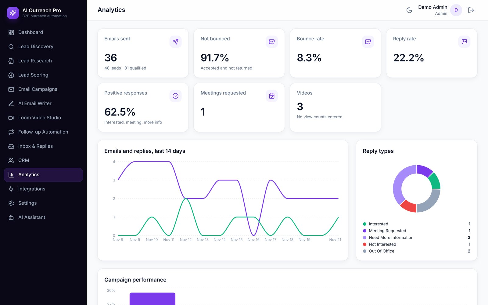
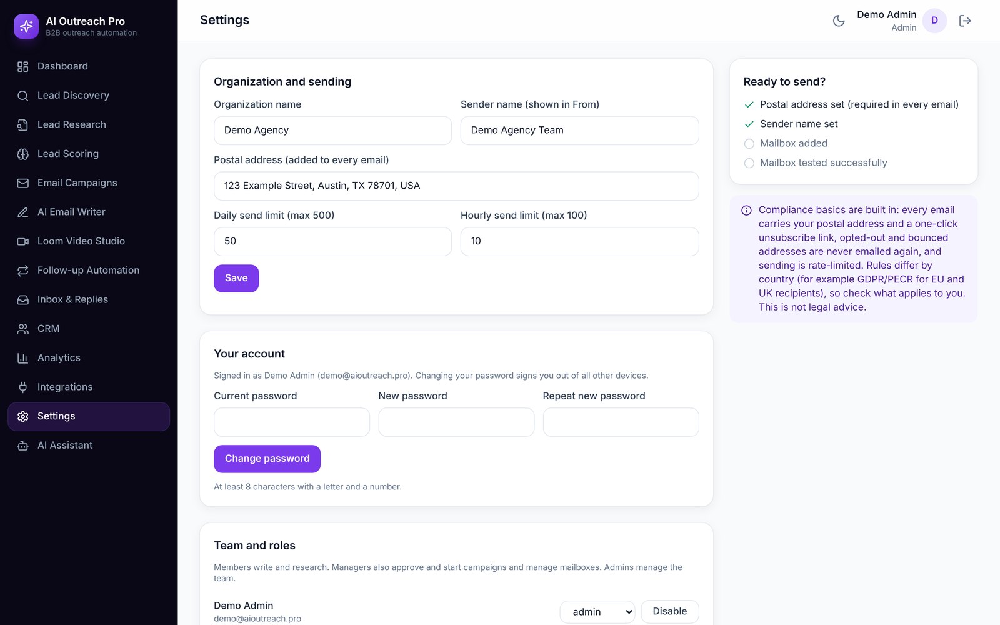

# AI Outreach Pro

AI-assisted B2B outreach platform: lead discovery, website research, lead scoring, personalized email and video scripts, follow-ups, reply classification, CRM and analytics. Human approval is required before anything is sent to a prospect.

See [ARCHITECTURE.md](ARCHITECTURE.md) for the design, schema, API plan and roadmap.

## Demo

[Watch the 50-second walkthrough](docs/demo.mp4) (recorded against the app running with the built-in sample data; no real people or emails are shown).

| | |
|---|---|
|  |  |
| **Dashboard**: pipeline, reply rate, email activity | **CRM**: lead profile, conversation, notes, export |
|  |  |
| **Lead scoring**: Hot / Warm / Cold tiers | **Campaigns**: nothing sends without manager approval |
|  |  |
| **Analytics** | **Settings**: password change, session revocation |

To try it yourself, follow the local setup below. With `SEED_DEMO_DATA=true` you can sign in as `demo@aioutreach.pro` / `Demo1234!` (local development only; the app refuses to start in production with the demo account enabled).

## Status

| Phase | Scope | Status |
|---|---|---|
| 1 | Structure, database, auth/RBAC, dashboard, frontend shell | **Done** |
| 2 | Lead import, dedupe, free email check, website research, scoring | **Done** |
| 3 | AI email writer, campaigns, sending, approvals, suppression | **Done** |
| 4 | Loom video workflow and scripts | **Done** |
| 5 | Follow-ups, reply detection and classification | **Done** |
| 6 | Analytics, CRM export, assistant, hardening, tests | **Done** |

All 14 pages are live. No fake buttons: everything shown is backed by the API.

## Runs with zero paid services

- Leads: CSV import and manual entry.
- Email check: syntax + DNS lookup (confirms the domain accepts mail, not that the mailbox exists).
- AI: optional. Use a free provider (Groq, Gemini) or local Ollama via `OPENAI_*` in `.env`; without it, research reports are extractive and say so.
- Sending and reading replies: Gmail/Outlook/any SMTP+IMAP with an app password (Integrations page), subject to your provider's daily limits.
- Scheduler: runs inside the app (every 60 s); no Redis or Celery needed.

## Local setup on Windows (PowerShell, no Docker, no PostgreSQL)

Local development uses a single SQLite file (`backend\dev.db`). PostgreSQL is only for production (see Deployment below).

**You need:** Python 3.12 or newer (python.org, tick "Add python.exe to PATH") and Node.js 20 or newer (nodejs.org).
Open PowerShell and go to the folder that contains `backend` and `frontend` (the project root):

```powershell
cd "C:\Users\DELL\Downloads\ai outreach pro\proj"      # change to your own path
```

### 1. Backend (one time)

```powershell
cd backend
python -m venv .venv
Set-ExecutionPolicy -Scope Process -ExecutionPolicy Bypass     # only needed if the next line says scripts are disabled
.\.venv\Scripts\Activate.ps1
python -m pip install --upgrade pip
pip install -r requirements.txt
python scripts\make_env.py        # creates backend\.env with fresh random SECRET_KEY and ENCRYPTION_KEY
alembic upgrade head              # creates the SQLite database tables
```

`make_env.py` never overwrites an existing `.env`. Do not commit `.env`; keep it, because `ENCRYPTION_KEY` protects the mailbox passwords you save in the app.

### 2. Frontend (one time)

```powershell
cd ..\frontend
npm ci
npm run build
```

### 3. Run

```powershell
cd ..\backend
.\.venv\Scripts\Activate.ps1      # if the window was closed and the (.venv) prefix is gone
uvicorn app.main:app --port 8000
```

Open **http://localhost:8000**. Demo login: `demo@aioutreach.pro` / `Demo1234!` (fictional data, local only). API docs: http://localhost:8000/docs. Stop with `Ctrl+C`.

**Developing the UI with hot reload** (two terminals): terminal 1 `cd backend; .\.venv\Scripts\Activate.ps1; uvicorn app.main:app --reload --port 8000`, terminal 2 `cd frontend; npm run dev`, then open http://localhost:5173.

### 4. Run the tests

```powershell
cd backend
pip install -r requirements-dev.txt
pytest -q                          # uses its own throw-away SQLite file, never your dev.db or your .env keys
```

### Troubleshooting

| Message / problem | Fix |
|---|---|
| `The database has no tables yet` | Run `alembic upgrade head` in the `backend` folder. |
| `running scripts is disabled` when activating | `Set-ExecutionPolicy -Scope Process -ExecutionPolicy Bypass`, then activate again. |
| `Address already in use` / port 8000 busy | Use another port: `uvicorn app.main:app --port 8001`. |
| Start over with an empty database | Stop the server, delete `dev.db`, `dev.db-wal` and `dev.db-shm` in `backend`, run `alembic upgrade head` again. |
| `database is locked` | Only one backend process may use `dev.db`; close other uvicorn windows. |
| Changed `ENCRYPTION_KEY` and saved mailboxes stopped working | Restore the old key in `.env`, or re-enter the mailbox passwords on the Integrations page. |

macOS/Linux: same steps with `source .venv/bin/activate` and `/` paths.

## Live preview (GitHub Pages, no server)

**https://shifafaheem05-lgtm.github.io/ai-outreach-platform/**: the React app running on bundled sample data, always on and free. Click **Try the demo** and browse every page, search leads, open lead profiles and generate sample emails. Actions that change data are switched off in this preview (it has no backend), so use the local setup below for the full app.

How it works: `VITE_STATIC_DEMO=true` swaps the HTTP layer for a mock adapter (`frontend/src/demo/mockApi.js`) that serves responses captured from the real backend (`node frontend/scripts/capture-demo-fixtures.mjs`). It is compiled out of normal builds. The workflow `.github/workflows/pages.yml` publishes it; enable it once under **Settings -> Pages -> Source: GitHub Actions**.

## Public demo (free, recruiters can open it any time)

`DEMO_MODE=true` turns the app into a safe public showcase:

- the login page offers **Try the demo (no sign-up)**, or visitors can **create their own workspace** and use it;
- sample data is loaded on first start (never duplicated). With a hosted PostgreSQL database, accounts and data are kept across restarts; with the throwaway SQLite option a restart resets everything;
- real email is never sent and mailboxes cannot be connected (the shared demo account also cannot change its password or users);
- sign-ups are capped (300 users) and the app refuses to start without a strong `SECRET_KEY`;
- it cannot be combined with `APP_ENV=production`, so the production safety checks are unchanged.

Settings are in [`.env.demo.example`](.env.demo.example). Deploy the repo's `Dockerfile` to any host that runs Docker images from GitHub (for example Render's free web service) and set those variables. Free hosts put idle apps to sleep; the first visit after a pause takes up to about a minute to wake it. To keep visitors' data, create a free PostgreSQL database (for example at neon.com; its free plan keeps data while compute sleeps, with a 1 GB limit) and use its connection string as `DATABASE_URL` (see `.env.demo.example`). Do not set `OPENAI_API_KEY` on a public demo.

## Deployment (Docker, PostgreSQL)

```bash
export SECRET_KEY=$(python -c "import secrets;print(secrets.token_urlsafe(48))")
export ENCRYPTION_KEY=$(python -c "from cryptography.fernet import Fernet;print(Fernet.generate_key().decode())")
export POSTGRES_PASSWORD=$(python -c "import secrets;print(secrets.token_urlsafe(24))")
export PUBLIC_BASE_URL=https://outreach.example.com     # must be reachable by recipients (unsubscribe links)
docker compose up -d --build
```

- `docker compose` refuses to start if any of those four values is missing. Save them somewhere safe: losing `ENCRYPTION_KEY` makes stored mailbox passwords unreadable.
- The container runs `alembic upgrade head` on start, as a non-root user, with a health check at `/api/health`. PostgreSQL is not exposed to the host.
- With `APP_ENV=production` the app **refuses to start** on: weak `SECRET_KEY`, missing/invalid `ENCRYPTION_KEY`, `SEED_DEMO_DATA=true`, SQLite, or a localhost `PUBLIC_BASE_URL`.
- Put it behind HTTPS (Caddy, nginx, a cloud load balancer). If the proxy is not on the container's loopback, set `FORWARDED_ALLOW_IPS` to its address so login rate-limiting sees real client IPs.
- **Run exactly one app process/replica.** The e-mail scheduler lives inside it. Sends are claimed atomically so an accidental second process will not double-send, but it is not a supported scale-out setup.
- Create your first admin by registering on the login page, then set `ALLOW_REGISTRATION=false` to close sign-up; add colleagues in Settings > Team.
- Backups: `docker compose exec db pg_dump -U postgres ai_outreach_pro > backup.sql`
- Upgrades: pull, `docker compose up -d --build` (migrations run automatically).

## Configuration

Everything is configured through environment variables. Local development: `backend/.env.example` (SQLite, created for you by `scripts/make_env.py`). Production: `.env.production.example` (PostgreSQL; the app refuses to start with unsafe values).
Generate an encryption key for stored credentials:

```bash
python -c "from cryptography.fernet import Fernet; print(Fernet.generate_key().decode())"
```

In production set `SECRET_KEY` and `ENCRYPTION_KEY` explicitly and set `SEED_DEMO_DATA=false`.

## Tests

```bash
cd backend && pip install -r requirements-dev.txt
pytest -q                                   # SQLite (default)
TEST_DATABASE_URL=postgresql+psycopg2://user:pw@localhost/empty_db pytest -q   # PostgreSQL
# browser end-to-end (server running with demo data; needs `npm i playwright`):
BASE_URL=http://localhost:8000 node scripts/e2e_smoke.mjs
```

## Compliance notes

- No prospect is contacted without an approval record (enforced from Phase 3).
- Suppression list, unsubscribe link, physical address and sending limits are enforced at send time.
- Loom has no public API to create or upload videos. The Video Studio produces scripts and a recording checklist; you record in Loom and paste the share link back.
- Website research respects robots.txt and stores source URLs; lead sources are licensed APIs and CSV import.
- Sending to EU/UK contacts requires a lawful basis. This software does not provide legal advice.


## Going live: important notes

- Security notes: sessions can be revoked (changing a password signs out every other device); mailbox hosts must be public addresses in production; see `docs/PROJECT_ANALYSIS.md` and `docs/CHANGES.md`.

- **Gmail**: turn on 2-Step Verification, create a 16-character App Password, add it on the Integrations page, then use "Test connection".
- **PUBLIC_BASE_URL** in `.env` must be a URL recipients can reach (not localhost), otherwise unsubscribe links in real emails will not work.
- **Compliance**: set your postal address and sender name in Settings; sending is blocked until you do. Opt-outs and bounces are suppressed permanently.
- **Approval flow**: campaign drafts -> submit -> manager approves -> start. One-off sends and inbox replies need explicit confirmation. The assistant never sends.
- **Production**: see **Deployment** above (the app refuses to start with unsafe settings).
- **Loom**: the app stores links and scripts; it cannot record or upload to Loom for you.
- **Email checks** confirm the domain accepts mail, not that the mailbox exists.

Single-server build: `cd frontend && npm run build`, then run uvicorn; the app serves the UI at http://localhost:8000.
